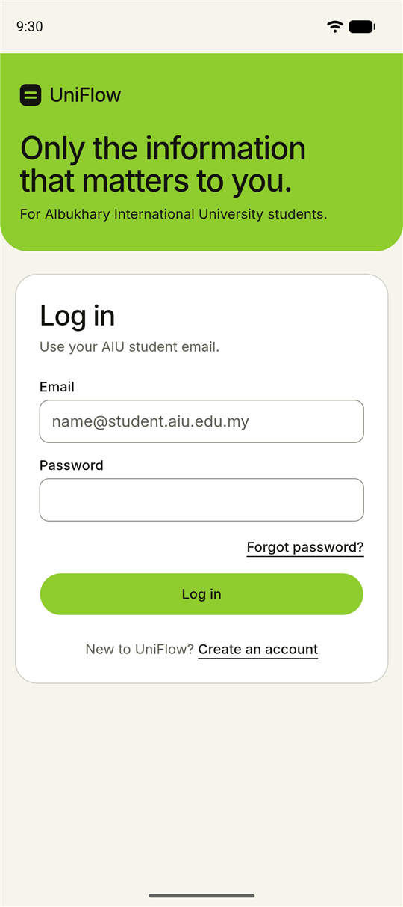
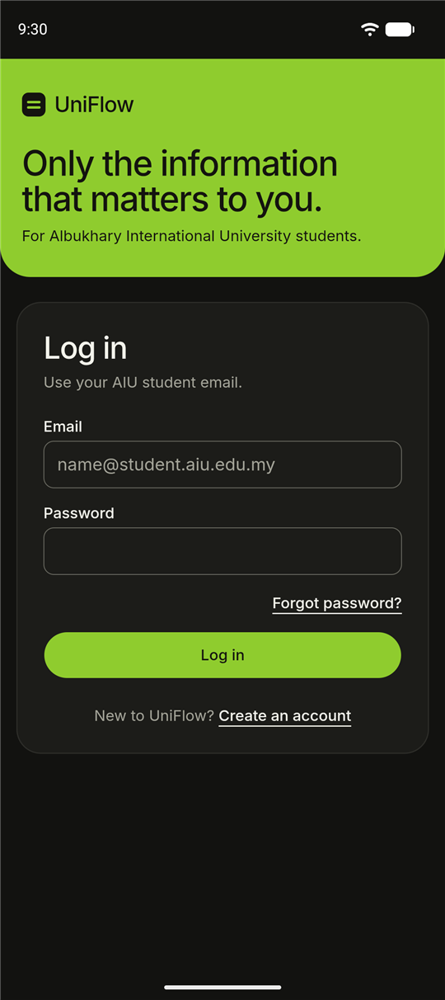
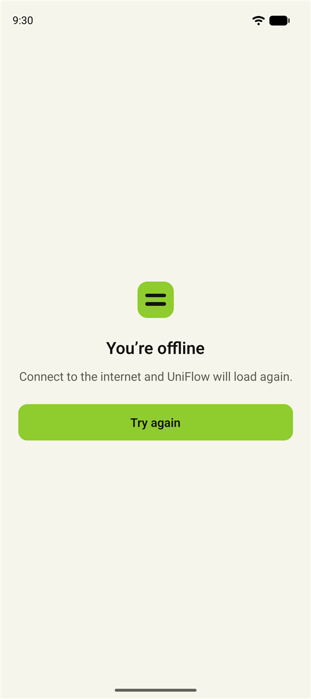

# UniFlow Mobile

The Android and iOS app for [UniFlow](https://uni-flow-inky.vercel.app), a web app that reads
students' academic WhatsApp and Telegram groups and surfaces what matters to each student:
messages that name them, deadlines and class changes.

The app is a native shell around the live website: one codebase for the product, with the
native parts a website can't provide (push notifications, an app icon badge, deep links,
an offline screen, system back navigation) and a strict security boundary between the two.

<p align="center">
  
  
  
  
</p>

**Stack:** Expo SDK 58 · React Native 0.88 · React 19 · TypeScript (strict, `noUncheckedIndexedAccess`) ·
react-native-webview · expo-notifications · EAS Build · Jest

## Features

- **The full UniFlow website** in a hardened WebView, with the status bar, safe areas and
  system bars following the page's light or dark theme.
- **Push notifications**: permission is asked for only after login, through an explanatory
  sheet (offered at most twice, a week apart). Separate Android channels let students
  silence the digest without missing class changes. Tapping a notification opens the
  matching page, whether the app was running or not.
- **App icon badge** in step with the website's unread count (exact count on iOS; on
  Android, cleared with the shade once everything is read).
- **Deep links** (`uniflow://insights/42`), checked against an allowlist of in-app routes.
- **Offline and error handling**: separate screens for offline, unreachable and server
  errors, automatic retry when the connection returns, and recovery when Android kills the
  WebView's renderer.
- **Android back button** walks the website's history before leaving the app.

## How it works

```
┌──────────────────────── UniFlow app ────────────────────────┐
│  AppScreen                                                  │
│   ├─ usePush ────────── permission, Expo push token,        │
│   │                      token rotation, foreground refresh │
│   ├─ useIncomingLinks ─ deep links + notification taps      │
│   └─ UniFlowWebView ─── navigation policy, back, errors     │
│          │  ▲                                               │
│  injected│  │postMessage (validated, ≤ 1 KB, fixed shapes)  │
│   script ▼  │                                               │
│   https://uni-flow-inky.vercel.app  (login, data, UI)       │
└─────────────────────────────────────────────────────────────┘
```

The website keeps its own authentication (an in-memory access token and an httpOnly
refresh cookie, same-origin through the Vercel proxy). The app never reads, stores or
forwards credentials. It hands the page only the device's Expo push token, which the
website registers with its own authenticated API call. The page reports back only harmless
facts: theme, layout, unread count and session state.

### Security decisions

- **Navigation policy** ([`navigationPolicy.ts`](src/web/navigationPolicy.ts)): every URL,
  including those opened by iframes and `window.open`, is either loaded (same origin only),
  opened outside the app (other `https`, `mailto:`, `tel:`, from the top frame only) or
  blocked (`intent:`, `javascript:`, `file:`, `data:` and the rest).
- **Strict URL parsing** ([`url.ts`](src/web/url.ts)) rejects credentials in URLs,
  backslashes, control characters and unusual hosts before any origin comparison.
- **Bridge validation** ([`bridge.ts`](src/web/bridge.ts)): messages are accepted only from
  the website's origin, in an exact versioned shape, up to 1 KB. Values reach injected
  scripts only through `JSON.stringify`.
- **Deep links and push payloads** map to an allowlist of routes
  ([`routes.ts`](src/web/routes.ts), [`payload.ts`](src/push/payload.ts)). A notification
  never carries a URL.
- **WebView hardening**: no file URLs, no geolocation, no camera or microphone
  streams for the page (photo uploads go through the system picker), no mixed content, HTTPS enforced at build time outside development.

### Notable problems solved

- **Doubled bottom inset on Android:** the website already pads for the system bar
  (`env(safe-area-inset-bottom)`), so the app detects a fixed bottom bar from the rendered
  page and drops its own inset only there.
- **Late script injection:** Android can run the bootstrap script before `<html>` exists
  (theme changes went unnoticed) or after the page has loaded, when restoring a page on
  Back (`DOMContentLoaded` never fires). The script handles both.
- **Push token refresh loop:** Android re-emits the current token whenever it's requested,
  so the token listener only reacts to a different token, and refreshes run one at a time.
- **Badge clearing on Android:** `setBadgeCountAsync(0)` dismisses every notification on
  some launchers, so Android clears the shade only when nothing is unread.

## Project structure

```
App.tsx                  splash screen, configuration check
src/
  AppScreen.tsx          composes the WebView, push and deep links
  config.ts              website origin, EAS project, user agent
  theme.ts               colors shared with the website
  useIncomingLinks.ts    deep links and notification taps → in-app paths
  web/                   WebView, navigation policy, bridge, routes, screen state
  push/                  permission, tokens, channels, payloads, badge
  components/            loading, error and push-offer screens
__tests__/               unit tests (85) for every policy and parser
scripts/                 dependency-free icon and splash generator
docs/                    setup and release guide, backend integration spec
```

The logic that decides things (navigation, routing, bridge parsing, push rules, screen
state) is in pure functions with dependency-injected platform calls, so it's unit-tested
without a device.

## Getting started

```bash
npm ci
npx eas-cli@latest build --profile development --platform android   # once
npm start
```

See [docs/setup.md](docs/setup.md) for build profiles, configuration, credentials and
releases.

```bash
npm run check    # tsc --noEmit, expo lint, jest
```

## Status

| | |
| --- | --- |
| Android | tested on a physical device and the emulator: login, uploads, back navigation, deep links, offline recovery, push delivery and taps, icon badge |
| iOS | configured (bundle ID, permission strings, push), not built yet: requires an Apple Developer account |
| Server-side push | the app side is complete; sending from the UniFlow backend is specified in [docs/backend-integration.md](docs/backend-integration.md) |
